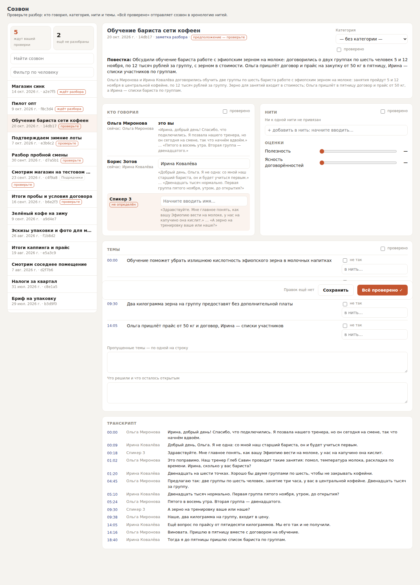
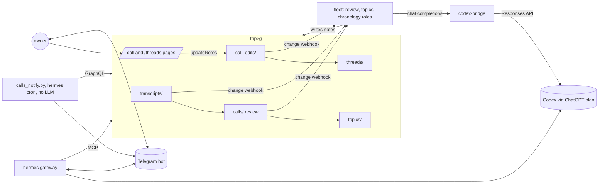
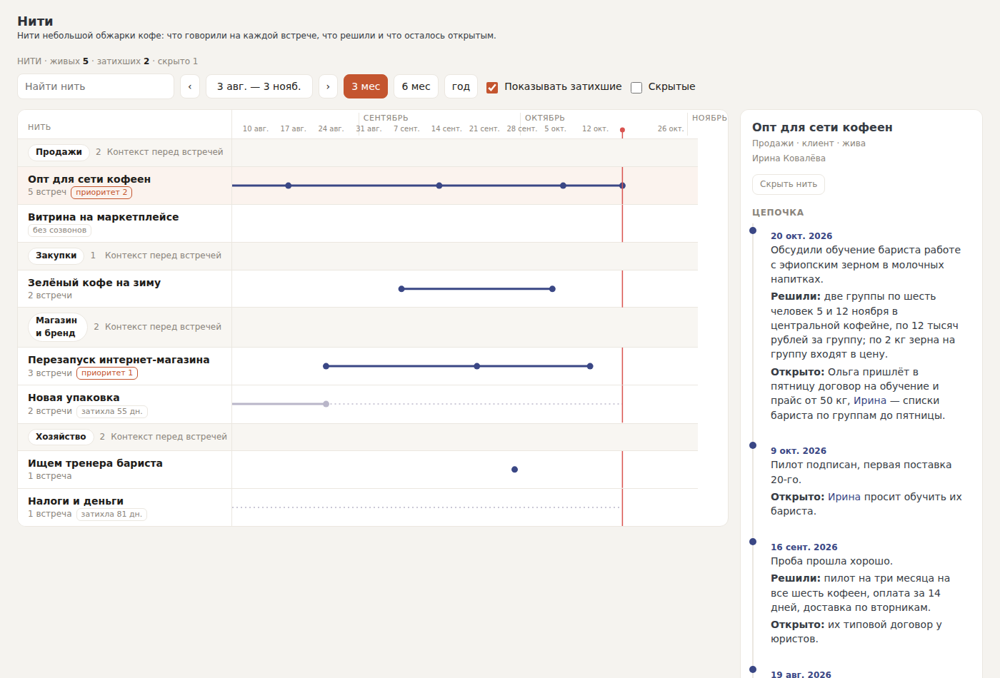
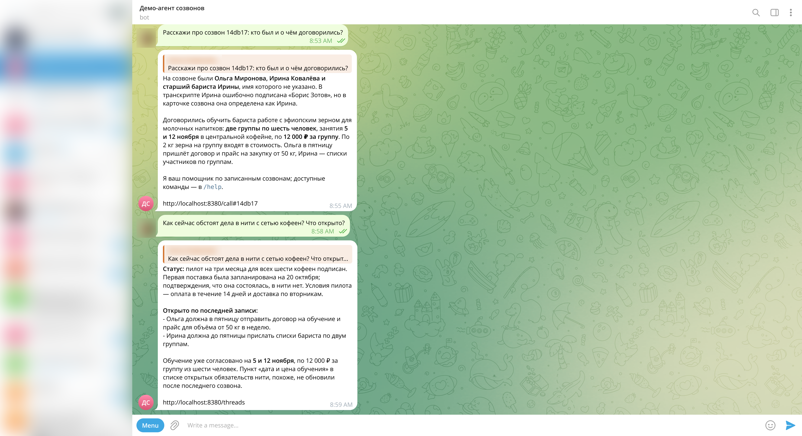

# Calls become threads

A docker compose demo of one workflow: recorded calls are reviewed by agents,
checked by their owner on a dashboard, and folded into long-running threads
that an assistant in Telegram can answer from.

It runs three public pieces side by side:

- **[trip2g](https://github.com/trip2g/trip2g)** holds the notes and serves
  the two dashboard pages (one call, all threads).
- **fleet** (`cmd/fleet` from the trip2g repository) runs the vault's role
  notes as agents whenever a matching note changes.
- **[Hermes Agent](https://github.com/NousResearch/hermes-agent)**, the
  upstream image, talks to you in Telegram and reads the vault over MCP.

Every model call goes to Codex through your ChatGPT subscription. All data is
invented: a small coffee roastery, its clients, suppliers and three months of
calls.



## What happens

1. A transcript lands in `transcripts/`.
2. The **review** role writes `calls/<id>.md`: who spoke under which label,
   the agenda, a category guess, `assumed: true`. It names a speaker only when
   the conversation shows who it is. It never trusts the recorder's label or
   title, which are often wrong (the sample call is labelled with the wrong
   person's name on purpose).
3. The **topics** role writes `topics/<id>.md`: a short summary and the topics
   with timecodes.
4. Within a minute the bot sends you one message with the link to that call's
   page.
5. You check the call on the page: fix speakers, pick the category and the
   thread, press **All verified** («Всё проверено»).
6. The **chronology** role adds one dated line about this call to each thread
   you picked.
7. Ask the bot about the call or the thread. It answers from the notes and
   ends every answer with the link to the call's page or to the threads page.



| Service | Image | Job |
|---|---|---|
| `minio` | `pgsty/silo` | File storage trip2g needs for assets |
| `trip2g` | `ghcr.io/trip2g/trip2g:0.12.0` | The vault, the pages, MCP at `/_system/mcp`, GraphQL |
| `seed` | `node` | Pushes `vault/` once with trip2g's own sync CLI |
| `fleet` | `ghcr.io/trip2g/trip2g:0.12.0`, run as `/fleet` | Registers webhooks for `vault/roles/*.md` and runs them |
| `codex-bridge` | `nousresearch/hermes-agent` | Turns fleet's chat-completions calls into Codex Responses calls with the Codex login Hermes stores |
| `hermes` | `nousresearch/hermes-agent:v0.22.2` | The Telegram assistant, with the `calls` skill and the notify job |
| `notify-job` | same | Creates the cron job once, then exits |

Fleet ships inside the trip2g image as a second binary, `/fleet`, so both
services run the same pinned image.

Fleet speaks OpenAI chat completions; a ChatGPT plan gives you the Codex
Responses API instead. `bridge/codex_bridge.py` is the small adapter in
between. It reuses Hermes's own Codex client, so it reads the same login from
the shared `hermes` volume and never holds a key of its own. It listens only
on the compose network and accepts only fleet's `BRIDGE_KEY`.

## Quickstart

You need Docker with compose, a ChatGPT plan that includes Codex, and a
Telegram account.

### 1. A Telegram bot

1. In Telegram, open [@BotFather](https://t.me/BotFather), send `/newbot`,
   and copy the token.
2. Find your numeric user id, for example with
   [@userinfobot](https://t.me/userinfobot). Only this user can talk to the
   bot, and the new-call messages go to this user.

```sh
cp .env.example .env
# set TELEGRAM_BOT_TOKEN and TELEGRAM_OWNER_ID in .env
```

### 2. Secrets and the vault

```sh
./scripts/setup.sh
```

It fills the remaining secrets in `.env`, starts trip2g and creates the API
key Hermes and the seed use. `.env` stays out of git.

### 3. Log in to Codex

```sh
docker compose run --rm --no-deps --user 10000:10000 --entrypoint hermes hermes auth add openai-codex
```

This is Hermes's own device login: open the URL it prints, sign in with your
ChatGPT account and enter the code. The tokens are stored in the `hermes`
volume (`/opt/data/auth.json`), which the bridge reads too. Hermes refreshes
them itself.

Already logged in with the Codex CLI? `./scripts/import-codex-login.sh` copies
`~/.codex/auth.json` into the volume instead. Codex rotates its refresh token
on use, so after Hermes refreshes it once the CLI's copy is spent and the CLI
asks you to log in again. The device login above avoids that.

### 4. Start

```sh
docker compose up -d
```

Then:

- open <http://localhost:8380>, sign in as `owner@example.com`; the stack runs
  trip2g with `DEV=true`, so the code is always `111111`;
- send your bot any message to open the chat.

Change the models with `HERMES_MODEL` and `ROLE_MODEL` in `.env`. Which Codex
models your plan offers is listed by
`docker compose exec hermes hermes model`.

## Try it

1. Drop the sample call into the vault:

   ```sh
   docker compose run --rm --no-deps seed node /scripts/drop-call.mjs /samples/barista-training.md
   ```

   It is stored as `transcripts/<today>-<id>.md` and prints the id.

2. Within about a minute the bot writes:

   ```
   Разобрал созвон «Обучение бариста сети кофеен» (2026-10-20).
   Проверьте, кто говорил и о чём: http://localhost:8380/call#14db17
   Не понял, кто: Спикер 3.
   ```

   The recorder labelled the client «Борис Зотов»; the review names her
   Ирина Ковалёва, because that is how she is addressed in the call.

3. Ask the bot about the call, for example «Расскажи про созвон 14db17: кто
   был и о чём договорились?». The answer ends with
   `http://localhost:8380/call#14db17`.

4. Open that link, choose the category, add the thread «Опт для сети
   кофеен», press «Всё проверено ✓».

5. Within a minute the thread gets its line. Open
   <http://localhost:8380/threads> and click the thread:

   

6. Ask the bot about the thread, for example «Как сейчас обстоят дела в нити
   с сетью кофеен? Что открыто?». The answer ends with
   `http://localhost:8380/threads`.

Telegram does not turn `localhost` addresses into links, so locally the bot
prints the address as text. Put the stack behind a real domain and set
`PUBLIC_URL` to make them clickable.



## The pieces

### The vault (`vault/`)

| Folder | What it holds |
|---|---|
| `transcripts/` | `Label \| MM:SS` lines, then what was said |
| `calls/` | Reviews: `type: review`, `speakers`, `speakers_confidence`, `assumed` |
| `topics/` | Summary and `## Темы` with `MM:SS \| topic` lines |
| `threads/` | `type: thread`; `## Хронология`, one line per call, then `## Открытые обязательства` |
| `people/`, `categories/` | One note each |
| `call_edits/` | Written by the call page: the owner's corrections and `verified` marks |
| `roles/` | The three fleet roles |
| `_layouts/calls/` | The dashboard layouts, unchanged from trip2g's `docs/_layouts/calls` |
| `call.md`, `threads.md` | The two pages and their settings |

The page settings are documented in trip2g's
[calls dashboard guide](https://github.com/trip2g/trip2g/blob/main/docs/en/user/calls-dashboard.md).

### The roles (`vault/roles/`)

Each role is a note: the frontmatter says when it runs and which paths it may
read and write, the body is the instruction. Fleet enforces the paths, so the
review role cannot touch threads and the chronology role can only write
`threads/`.

- `review.md` — on a new transcript, writes the review.
- `topics.md` — on a new review, writes the topic map.
- `chronology.md` — on every save of a call's edits note, does nothing until
  all four marks are verified, then adds one line per picked thread. It skips
  a thread that already has a line for the call, and anchors its edit on the
  heading after the list, so two runs at once cannot both add the line.

Edit a role in `vault/roles/`, push it (the seed runs once; use trip2g's sync
CLI or the admin editor), and fleet picks it up within 30 seconds.

### The assistant (`hermes/`, `skills/`)

- `hermes/config.yaml` is mounted as Hermes's managed config: provider
  `openai-codex`, the vault as MCP server `vault` (API key in `X-API-Key`),
  the `calls` skill, and only two toolsets in Telegram — skills and the vault.
  The bot can read the vault and nothing else.
- `skills/calls/SKILL.md` tells it where calls and threads live, to answer
  from the notes only, and to end every answer with the page link.
- `hermes/scripts/calls_notify.py` runs every minute as a Hermes cron job in
  no-agent mode: it lists `calls/`, and prints one message per review it has
  not seen; Hermes delivers what it prints to your Telegram. It spends no
  tokens. On its first run it only records the reviews already there.

## What is synthetic

Everything in `vault/` and `samples/`: the roastery, its people, companies,
calls, threads and numbers are made up. The layouts and the demo vault come
from trip2g's documentation. No real conversation is in this repository.

## Notes

- This is a local demo. `DEV=true` makes the sign-in code `111111` for
  anyone who can reach the port; do not expose it as is.
- trip2g 0.12.0 sometimes crashes on its very first boot while it creates the
  database; `restart: unless-stopped` brings it back.
- `docker compose down -v` deletes everything, including the Codex login.
